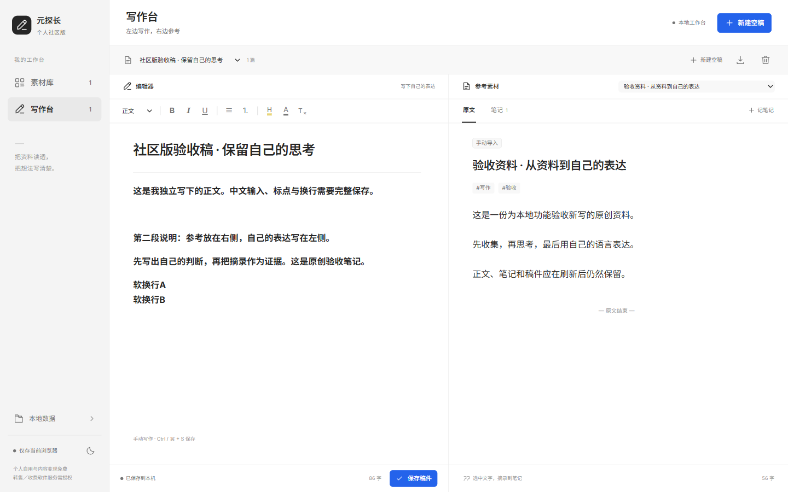

<p align="center">
  <strong>元探长 · 个人社区版</strong><br/>
  <sub>把资料读透，把想法写成作品。</sub>
</p>

<p align="center">
  <a href="https://github.com/wyghxy/yuantanzhang-community/actions/workflows/ci.yml"></a>
  
  
  
</p>

<p align="center">
  <a href="#快速开始"><strong>开始使用</strong></a>
  &nbsp;·&nbsp;
  <a href="#公开范围"><strong>公开范围</strong></a>
  &nbsp;·&nbsp;
  <a href="CONFIGURATION.md"><strong>配置说明</strong></a>
  &nbsp;·&nbsp;
  <a href="LICENSING.md"><strong>许可</strong></a>
</p>

<p align="center">
  
</p>

## 一张桌面，完成从阅读到表达

元探长个人社区版是一个**本地优先、源码公开**的个人创作工作台。素材在旁，写作在前，所有资料默认留在自己的浏览器里。

- **个人版**：开源版，源码公开，本地运行；个人自用及本人账号内容变现免费。
- **元空间**：联网版，商业产品入口：[yuantanzhang.cn/workspace](https://yuantanzhang.cn/workspace)。

> 本仓库采用 PolyForm Noncommercial 1.0.0 及项目补充的个人创作授权。准确说法是 **source-available / 源码公开个人版**，不是 OSI 标准开源项目。

## 快速开始

环境：Node.js 22+、pnpm 9.15.9。

```bash
pnpm install --frozen-lockfile
pnpm dev
```

打开 `http://127.0.0.1:3669/`，工作台位于 `/desk/`。

生成静态站点：

```bash
pnpm build
```

构建产物位于 `out/`。它是静态前端，不需要业务数据库、账号系统或供应商密钥。

## 当前能做什么

| 能力 | 状态 |
| --- | --- |
| 手动粘贴正文、导入 TXT / Markdown | 可用 |
| 记录来源链接并手动打开原文 | 可用 |
| 搜索、来源筛选与素材整理 | 可用 |
| 摘录原文并添加笔记 | 可用 |
| 富文本手动写作、标题、强调、高亮与列表 | 可用 |
| 稿件手动保存与 Markdown 导出 | 可用 |
| JSON 本地备份与合并导入 | 可用 |
| 浅色 / 深色主题与手机布局 | 可用 |
| 平台自动采集、视频下载、ASR | 本仓库不包含 |
| 模型调用、账号、积分与计费 | 本仓库不包含 |

“记录来源链接”只保存地址，不会请求来源平台，也不代表已经取得自动抓取或转载权限。

## 数据留在本机

素材、稿件、笔记和主题偏好保存在当前来源对应的浏览器 IndexedDB / `localStorage` 中。

- 不上传到作者侧业务后台；
- 不要求注册；
- 不包含遥测或广告脚本；
- 更换域名、端口、浏览器或清理站点数据后，旧数据可能不可见；
- 请定期导出 JSON，并把备份保存在自己控制的位置。

浏览器本地存储不是云备份。详细数据边界见 [PRIVACY.md](PRIVACY.md)、[CONFIGURATION.md](CONFIGURATION.md) 与 [DISCLAIMER.md](DISCLAIMER.md)。

## 公开范围

### 包含

- 自有静态适配的公开首页；
- 个人素材库、阅读摘录与手动写作台；
- 本地 IndexedDB、JSON 备份和 Markdown 导出；
- 自托管字体、自有界面代码、测试和构建配置；
- 许可、第三方通知、品牌、隐私、安全和免责声明。

### 不包含

- 商业管理台、账号体系、会员积分和支付计费；
- 自动采集、视频下载、转写与供应商代理接口；
- 元创作、元剪辑、元直播、账号运营等商业模块；
- 云托管、生产配置、数据库、用户数据、密钥或私有连接器；
- 原站未完成逐项授权的旧图片、作品封面和受限适配引擎。

本仓库是**可以独立运行的完整个人前端**，不是原线上商业项目的逐字节镜像。

## 技术栈

`Next.js 16` · `React 19` · `TypeScript` · `Tiptap` · `IndexedDB`

页面只使用本项目自有组件与基础 SVG 图标。第三方依赖和自托管字体的许可证见 [THIRD_PARTY_NOTICES.md](THIRD_PARTY_NOTICES.md)。

## 验证

```bash
pnpm test
pnpm typecheck
pnpm licenses:inventory
pnpm build
```

CI 对每次主分支推送和 Pull Request 执行同一组测试、类型检查、依赖许可清单和构建。

## 已知限制

- 这是 `0.1.0` 个人预览版，自动采集、模型和转写尚未包含；
- 尚未实现跨标签页写入冲突协调，请同一时间只在一个标签页编辑；
- 浏览器离开生命周期可能阻止自动保存，请使用“保存稿件”或 `Ctrl / ⌘ + S` 并确认保存结果；
- 真实语音输入法与所有浏览器组合尚未完成系统性兼容验收；
- 不把浏览器本地保存当作唯一备份。

## 许可摘要

- 个人自用、整理资料、学习和创作免费；
- 本人实际控制账号的广告、带货、赞助及平台创作收入，不需要另付软件授权费；
- 转售软件、销售使用权、经营收费 SaaS / API、代部署或对外托管需要另行书面授权；
- 第三方组件、字体、用户输入内容和品牌资源继续适用各自权利与许可。

完整条文以 [LICENSE](LICENSE)、[LICENSING.md](LICENSING.md) 和 [PERSONAL-USE-GRANT.md](PERSONAL-USE-GRANT.md) 为准。

## 反馈与安全

问题反馈请使用仓库 Issues。不要在公开 Issue 中上传真实稿件、备份、账号、Cookie、令牌或可被利用的敏感漏洞材料。安全问题请按 [SECURITY.md](SECURITY.md) 私密报告。

---

<p align="center">
  <strong>个人版，把工具交给你。</strong><br/>
  <sub>元空间，把完整创作链路留在联网工作台。</sub>
</p>
